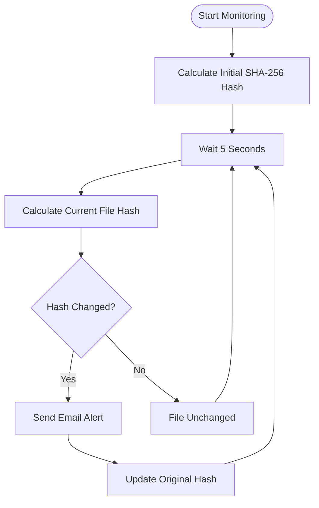

# 🔐 FILE INTEGRITY MONITORING SYSTEM

<p align="center">
  
  
  
  
</p>

<p align="center">
  A Python-based cybersecurity automation project that monitors file integrity, detects modifications using SHA-256 hashing, and sends automated email alerts.
</p>

---

## 📌 Overview

File Integrity Monitoring (FIM) is a security technique used to detect unauthorized or unexpected changes to files.

This project implements a simple automated file integrity monitoring system using Python.

It continuously monitors a specified file, calculates its SHA-256 hash, and compares it with the previously stored hash value. When a modification is detected, the system automatically sends an email notification.

## ✨ Key Features

| Feature | Description |
|---|---|
| 🔍 File Monitoring | Continuously monitors a specified file |
| 🔐 SHA-256 Hashing | Generates cryptographic hash values |
| 🚨 Change Detection | Identifies file modifications through hash comparison |
| 📧 Email Notifications | Sends automated email alerts |
| ⏱️ Continuous Monitoring | Checks file integrity every 5 seconds |
| 🔒 Secure SMTP | Uses SSL for Gmail communication |

## ⚙️ How It Works

The monitoring process follows these steps:



### 🔄 Monitoring Workflow

1. The program calculates the initial SHA-256 hash of the monitored file.
2. It waits for 5 seconds.
3. It calculates the current hash again.
4. It compares the current hash with the previous hash.
5. If the values differ, an email alert is generated.
6. The previous hash is updated.
7. The monitoring process continues.

## 🛠️ Technologies Used

| Technology | Purpose |
|---|---|
| Python | Core programming language |
| hashlib | SHA-256 hash generation |
| smtplib | Sending email notifications |
| ssl | Secure SMTP communication |
| email.message | Creating email messages |
| csv | Reading email credentials |
| time | Implementing monitoring intervals |

## 📂 Project Structure

```text
File-Integrity-Monitoring/
│
├── main.py
├── security.log
├── README.md
├── .gitignore
└── screenshots/
    └── monitoring-demo.png
```

## 🚀 Installation & Usage

### 1. Clone the Repository

```bash
git clone https://github.com/Shynushynu/File-Integrity-Monitoring.git
```

### 2. Navigate to the Project Directory

```bash
cd File-Integrity-Monitoring
```

### 3. Configure Email Credentials

Create a local file named `mailPass.csv` in the project directory.

Format:

```csv
your_email@gmail.com,your_gmail_app_password
```

**Important:** Use a Gmail App Password and never upload your credentials file to GitHub.

### 4. Run the Program

```bash
python main.py
```

## 📸 Project Demonstration

Screenshots of the monitoring process and email notifications will be added here.

## 🎯 Learning Outcomes

Through this project, I gained practical experience with:

- File Integrity Monitoring concepts.
- Cryptographic hashing using SHA-256.
- Python-based security automation.
- Automated email notifications.
- Secure SMTP communication.
- Continuous file monitoring.

## 🔮 Future Improvements

- Monitor multiple files and directories.
- Store hash values persistently.
- Generate detailed monitoring reports.
- Add logging functionality.
- Implement configurable monitoring intervals.

## ⚠️ Disclaimer

This project is developed for educational purposes to demonstrate basic file integrity monitoring and cybersecurity automation concepts. It is not intended to replace enterprise-grade security monitoring solutions.

---

<p align="center">
  <b>🔐 Built with Python | Cybersecurity Automation</b>
  <br/>
  <i>Learning by building practical security projects.</i>
</p>

<p align="center">
  Developed by <b>Shynu</b>
</p>
